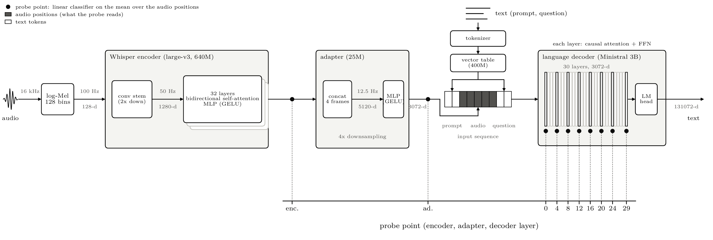
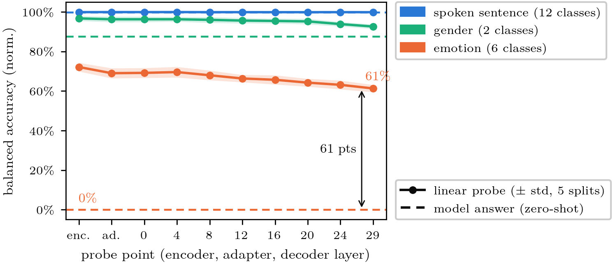
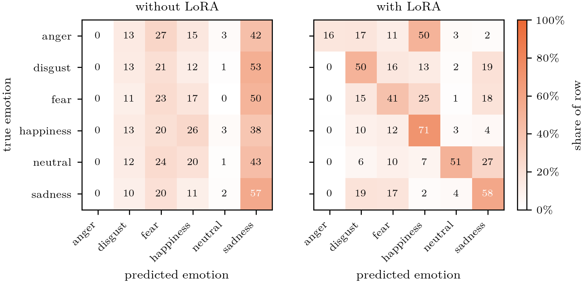

# Voxtral entend l'émotion, mais ne sait pas la dire

On fait écouter des phrases jouées par des acteurs à [Voxtral-Mini-3B](https://arxiv.org/abs/2507.13264), le modèle audio de Mistral. On regarde deux choses :

1. **Ce que le modèle sait** : on lit ses calculs internes, couche par couche.
2. **Ce que le modèle dit** : on lui pose la question, et on regarde sa réponse.

## Le problème en une phrase

L'émotion de la voix est bien présente à l'intérieur du modèle, mais quand on lui demande « quelle émotion ? », il répond au hasard.

## Pourquoi

Voxtral a appris uniquement à partir de transcriptions : répéter ce qui est dit, répondre à des questions sur le texte. On ne lui a jamais demandé de parler du ton de la voix. Il l'entend, mais n'a jamais appris à le dire.

## Comment on le mesure

- **Les données** : [CREMA-D](https://github.com/CheyneyComputerScience/CREMA-D), 91 acteurs qui disent 12 phrases sur 6 émotions (colère, dégoût, peur, joie, neutre, tristesse).
- **Ce que le modèle sait** : à chaque étape du modèle, un petit classifieur (une *probe*) essaie de retrouver la phrase, le genre et l'émotion à partir des calculs internes. S'il y arrive, l'information est là.
- **Ce que le modèle dit** : on lui pose la question avec un choix de réponses, sur des voix qu'il n'a jamais entendues.

Tous les scores sont **normalisés** : 0 % = hasard, 100 % = parfait.



Le son passe par l'encodeur Whisper, puis l'adaptateur, puis le décodeur de langage. Les points noirs sont les endroits où l'on place une probe : ce sont les abscisses de la figure suivante.

## Résultat 1 : l'écart entre savoir et dire



- **Traits pleins** : ce que le modèle sait. **Tirets** : ce qu'il dit.
- **Phrase (bleu)** : il la sait et la dit, à 99,8 %. C'est son métier.
- **Genre (vert)** : il le sait (93 à 97 %) et le dit bien (88 %).
- **Émotion (orange)** : il la sait (72 % au début, 61 % à la dernière couche), mais il la dit à **0 %**. Il répond presque toujours la même chose.

## Résultat 2 : un petit entraînement suffit à débloquer

On ajoute au modèle une petite correction entraînable (une [LoRA](https://arxiv.org/abs/2106.09685), moins de 1 % des paramètres), et on lui apprend à répondre « quelle émotion ? » par un mot. On teste ensuite avec une **formulation jamais vue** pendant l'entraînement.

| | Sans LoRA | Avec LoRA |
| --- | --- | --- |
| Émotion, question jamais vue | 3,9 % | **37 %** |
| Phrase | 99,8 % | 99,8 % |
| Genre | 88 % | 88 % |
| Probe émotion, dernière couche | 61 % | 62 % |

- **L'émotion remonte à 37 %**, soit environ 60 % du chemin vers ce que le modèle sait (61 %).
- **Rien n'est cassé** : la phrase et le genre ne bougent pas.
- **Les probes ne bougent pas** : la LoRA n'a rien ajouté, elle a ouvert l'accès à une information déjà présente.



Lignes : l'émotion jouée. Colonnes : l'émotion répondue.

- **Sans LoRA (gauche)** : chaque ligne se ressemble, il répond surtout « sadness » quelle que soit l'émotion. Il n'écoute pas le ton.
- **Avec LoRA (droite)** : la diagonale apparaît. Seule la colère reste mal reconnue, souvent confondue avec la joie.

## À retenir

Le modèle perçoit l'émotion, mais son entraînement ne lui a jamais appris à s'en servir. La vraie correction serait de l'entraîner avec des données qui parlent du ton de la voix (comme [DeSTA2](https://arxiv.org/abs/2409.20007)). Une LoRA légère en montre déjà une bonne partie.

## Les fichiers

| Fichier | Rôle |
| --- | --- |
| `download_cremad.py` | Télécharge CREMA-D |
| `extract.py` | Fait écouter chaque clip, garde les calculs internes |
| `probe.py` | Entraîne les probes |
| `behavioral.py` | Pose les questions au modèle |
| `lora.py` | Entraîne la LoRA |
| `plot.py`, `plot_confusion.py`, `plot_architecture.py` | Tracent les figures |
| `ROADMAP.md` | La question, le protocole et les réponses en bref |

```bash
python download_cremad.py data/CREMA-D
python extract.py data/CREMA-D outputs
python probe.py outputs
python behavioral.py outputs
python lora.py outputs
LORA=outputs/lora.pt python behavioral.py outputs
python plot.py outputs && python plot_confusion.py outputs
```

Sur le serveur GPU, chaque script se lance via `./run.sh` (par exemple `GPU=1 ./run.sh extract.py data/CREMA-D outputs`).
