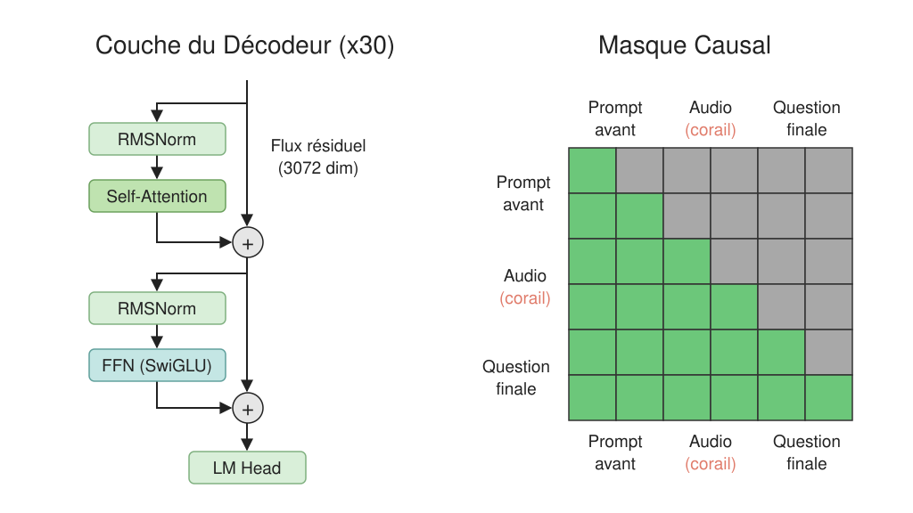

Voici une explication structurée et visuelle du fonctionnement interne du décodeur de langage dans l'architecture Voxtral (basée sur un Transformer auto-régressif comme Ministral 3B pour Voxtral Mini ou Mistral Small 3.1 24B pour Voxtral Small), accompagnée d'un schéma synthétique et d'un schéma textuel détaillé.



## 1. Schéma détaillé côte à côte (Architecture + Masque Causal)

Pour bien visualiser chaque étape décrite dans votre texte, voici également la représentation exacte sous forme de schéma structurel :

```
====================================================================================================
      PARTIE GAUCHE : UNE COUCHE DU DÉCODEUR                PARTIE DROITE : LE MASQUE CAUSAL
        (Répétée ~30 fois de haut en bas)                   (Qui a le droit de regarder qui ?)
====================================================================================================

          Entrée à la couche k-1                              Colonnes = Positions consultées (Clés/Valeurs)
     (Sortie de l'adaptateur audio 12.5 Hz                    [Prompt 1] [Audio 1] [Audio 2] [Question]
      ou des embeddings texte : 3072 dim)                          |         |         |         |
                     │                                   Lignes    ▼         ▼         ▼         ▼
       ┌─────────────┼─────────────┐                     (Requêtes)
       │             │             │                     Prompt 1 [🟢 OUI] [⚪ NON]  [⚪ NON]  [⚪ NON]
       │             ▼             │
       │        [ RMSNorm ]        │  (Stabilise         Audio 1  [🟢 OUI] [🟢 OUI] [⚪ NON]  [⚪ NON]
       │             │             │   l'échelle)        (corail)  └── Voit le prompt fixe avant lui !
       │             ▼             │
       │    ┌─────────────────┐    │                     Audio 2  [🟢 OUI] [🟢 OUI] [🟢 OUI] [⚪ NON]
  Flux │    │ SELF-ATTENTION  │◄───┼── (Seul endroit     (corail)  └── Fusionne les frames audio voisines,
résiduel    │  (Requêtes/Clés │    │    où les positions               mais NE VOIT PAS la question !
 (Voie │    │   /Valeurs)     │    │    communiquent
directe│    └────────┬────────┘    │    selon le masque) Question [🟢 OUI] [🟢 OUI] [🟢 OUI] [🟢 OUI]
 3072d)│             │             │                     (dernier  └── Goulot d'étranglement : voit TOUT
       │             ▼             │                      token)       et rapatrie l'info pour répondre.
       └──────────►( + )           │  1re addition
                     │             │  (Correction d'attention ajoutée au flux résiduel)
       ┌─────────────┼─────────────┘
       │             │
       │             ▼
       │        [ RMSNorm ]           (Stabilise l'échelle)
       │             │
       │             ▼
       │    ┌─────────────────┐
       │    │  FFN (SwiGLU)   │       (Traitement individuel position par position :
       │    │ Sans regarder   │        c'est ici que le traitement lexical peut recouvrir
       │    │  les voisins    │        ou atténuer l'émotion / le locuteur)
       │    └────────┬────────┘
       │             │
       └──────────►( + )              2e addition
                     │                (Correction FFN ajoutée au flux résiduel)
                     ▼
          Sortie de la couche k ──────► [ C'est ici qu'on branche la sonde ("Probing") ! ]
                     │
            (Après ~30 couches)
                     ▼
               [ LM Head ]            (Uniquement sur la dernière position pour prédire le 1er mot)
====================================================================================================
```

## 2. Explication étape par étape du fonctionnement

### A. En amont du décodeur : d'où viennent les vecteurs ?

Dans Voxtral, l'audio brut est d'abord transformé en spectrogramme log-Mel puis encodé par un encodeur dérivé de Whisper large-v3 à une fréquence de 50 Hz. Une couche d'adaptation (Audio Adapter, un MLP) sous-échantillonne ensuite ces représentations d'un facteur 4x (passant à 12,5 Hz) pour produire les positions audio (les vecteurs « corail ») qui entrent dans le décodeur de langage au même titre que les embeddings de texte.

### B. Le Flux Résiduel : « l'autoroute centrale » (à gauche)

* **Un vecteur par position** : Chaque token de la séquence (qu'il s'agisse d'un token de texte ou d'un segment audio issu de l'adaptateur) possède son propre vecteur de 3072 dimensions qui descend verticalement à travers toutes les couches du décodeur.
* **Additions et non remplacements (`+`)** : Lorsqu'un vecteur traverse une couche $k$, il n'est jamais effacé. Les sous-blocs calculent un vecteur de correction qui vient s'additionner au vecteur existant :

  $$\text{État}_{k} = \text{État}_{k-1} + \text{Attention}(\text{RMSNorm}(\text{État}_{k-1})) + \text{FFN}(\text{RMSNorm}(\dots))$$

* **Conséquence pour l'information audio** : Ce que l'adaptateur injecte au départ survit par défaut dans ce flux résiduel. Si une information paralinguistique (comme l'émotion ou l'identité du locuteur) disparaît au fil des couches, ce n'est pas parce qu'une couche la supprime brutalement, mais parce que les corrections successives ajoutées aux cercles `(+)` finissent par la noyer (la recouvrir) sous des caractéristiques purement textuelles ou lexicales.

### C. Les deux sous-blocs d'une couche : Communication vs Calcul local

1. **La Self-Attention (communication horizontale entre positions)** :
   * C'est le seul moment où les positions échangent de l'information.
   * Chaque position émet une Requête ($Q$), la compare aux Clés ($K$) des positions qu'elle a le droit de voir, et récupère une moyenne pondérée de leurs Valeurs ($V$).
   * Rôle pour l'audio : Une position audio peut lire les positions audio précédentes pour assembler plusieurs trames phonétiques en un mot cohérent.
   * Rôle pour la question : Le dernier token de la question utilise l'attention pour « aller piocher » l'information pertinente directement dans les positions audio.
2. **Le FFN / Réseau Feed-Forward avec SwiGLU (calcul vertical isolé)** :
   * Ici, les positions sont totalement cloisonnées : chaque vecteur de 3072 dimensions est transformé seul, sans aucune visibilité sur ses voisins.
   * C'est l'atelier de transformation interne de chaque position. Comme le décodeur est entraîné pour prédire des tokens de texte, le FFN privilégie les dimensions utiles à la sémantique et à la syntaxe, et tend à atténuer progressivement les dimensions acoustiques (émotion, timbre) jugées secondaires pour prédire le mot suivant.

## 3. Le Masque Causal (à droite) et ses 3 conséquences clés

Le décodeur étant auto-régressif, il applique une grille triangulaire inférieure : une ligne $i$ ne peut lire que les colonnes $j \le i$ (en vert). Si votre séquence d'entrée est structurée sous la forme :

$$\underbrace{\text{[Prompt fixe]}}_{\text{Avant}} \longrightarrow \underbrace{\text{[Positions Audio (corail)]}}_{\text{Milieu}} \longrightarrow \underbrace{\text{[Question posée]}}_{\text{Après}}$$

Cela entraîne trois effets majeurs :

1. **L'audio voit le prompt initial** : Les vecteurs audio intègrent dès la première couche d'attention le contexte placé avant eux (d'où l'importance de garder un prompt amont strictement fixe lors de vos expériences).
2. **L'audio est aveugle à la question finale** : Puisque la question est placée après l'audio dans la séquence, le masque causal bloque toute lecture vers le futur. Les représentations cachées aux positions audio évoluent de la couche 1 à la couche 30 sans savoir quelle question sera posée. Sonder (prober) les positions audio à la couche $k$ mesure donc purement la capacité intrinsèque du décodeur à préserver ou dégrader l'information acoustique au fil de son traitement naturel.
3. **Le dernier token est un goulot d'étranglement (bottleneck)** : Seul le tout dernier token (à la fin de la question) voit l'intégralité de la séquence (prompt + audio + question) et sert d'entrée à la LM Head pour générer le premier token de la réponse.

## 4. Comment interpréter votre expérience de Probing grâce à ce schéma ?

En sondant la présence de l'émotion dans le flux résiduel des positions audio couche après couche ($k = 1 \dots 30$), ce schéma permet de diagnostiquer exactement où se situe un éventuel blocage :

* **Cas 1 : La courbe de probing sur les positions audio chute au fil des couches.**
  * Diagnostic : Ce sont les sous-blocs (notamment les FFN) qui, au fil des additions `(+)`, recouvrent l'information émotionnelle par du traitement purement lexical. Le post-entraînement (finetuning supervisé sur des paires texte/audio synthétiques) a appris au décodeur à ignorer ces dimensions.
* **Cas 2 : La courbe de probing reste haute jusqu'à la dernière couche sur les positions audio, mais le modèle répond mal à la question.**
  * Diagnostic : L'information survit parfaitement dans le flux résiduel des positions audio ! Le problème se situe alors dans l'attention du dernier token de la question (et la LM Head) : le dernier token ne va pas « chercher » cette information pourtant disponible dans les colonnes audio lors du mécanisme de Self-Attention.
